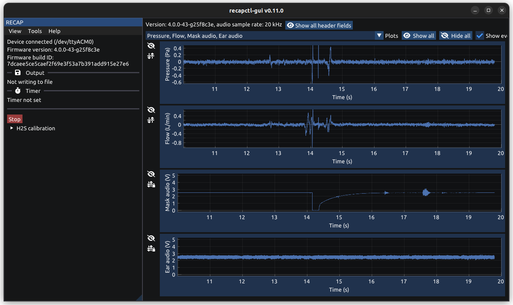

# RECAP USB reader



Cross-platform client for RECAP data collection device. Provides a command line
application `recapctl` and a GUI `recapctl-gui`.

## Building

Building requires `cmake` version >= 3.22 and
[uv](https://docs.astral.sh/uv/) (used to manage build-time Python dependencies
for the lint targets, GLFW icon generation, and tests).

Various build options are available and can be set by passing to `cmake` with
the `-D[OPTION]=[on/off]` flags during build configuration. Run `cmake -L` in
the build directory to list the current configuration.

Below are the available options with their default values.

```bash
# Build the CLI
-DRECAP_USB_READER_BUILD_CLI=on

# Build the GUI
-DRECAP_USB_READER_BUILD_GUI=on

# Build unit tests. Run tests with `ctest --test-dir <build-dir>` or just
# `ctest` if inside the build directory.
-DRECAP_USB_READER_BUILD_TESTS=on

# Embed a font file into the built binary and use that as the GUI font,
# otherwise the built program will try to load a system font from the
# filesystem.
-DRECAP_USB_READER_GUI_EMBED_FONT=off

# If `on`, use a simulated data collection device for the CLI and GUI. Useful
# for testing without requiring the physical device.
-DRECAP_USB_READER_MOCK_READER=off

# Whether to disable demos in the GUI. I recommend keeping them enabled (the default) for
# development.
-DRECAP_USB_READER_GUI_DISABLE_DEMOS=off
```

### Linux

Requires pkg-config, GLFW (with OpenGL 3), and GTK3, Inkscape, and ImageMagick
(the latter two are needed for generating the icon file). For example, on
Ubuntu/Debian these can be installed using:

```
apt install pkg-config libgtk-3-dev libglfw3-dev inkscape imagemagick
```

To configure and build using `make`:

```
mkdir build
cd build
cmake [OPTIONS] -DCMAKE_BUILD_TYPE=[Debug/Release] ..
make -j
```

### Windows

Inkscape and ImageMagick and their respective command line tools (`inkscape` and
`magick`) need to be installed to generate the icon file at build time. (These
do not need to be installed to just run the program.)

To configure and build using MSVC:

```
cmake [OPTIONS] -B build -G "Visual Studio 17 2022" .
cmake --build build --config [Release/Debug] --parallel
```

The executable produced by the `Release` build should just run on the user's PC
without any extra dependencies provided their version of Windows is shipped with
DirectX 12 (which Windows 10 and 11 are).

The `Debug` build will require Visual Studio to be installed to run.

### macOS

Currently no support for building the GUI with native macOS libraries (Cocoa,
Metal etc.). However, adding support should be relatively straightforward:
simply adapt one of the ImGui examples for macOS to follow the platform support
files in the `gui/platform` dir. There is also (untested) CMake support for
native macOS support in `gui/vendor/imgui.cmake`.

Alternatively, the library should build and run fine using OpenGL and GLFW, as
long as these are installed. See the [Linux](#Linux) instructions above.
However, I have not had the chance to actually test the app on macOS.

## Testing

To run unit tests, make sure you have run `cmake` with
`-DRECAP_USB_READER_BUILD_TESTS=on`. Then, after building the project, in the
build directory run `ctest`.

## Linting

There are three build targets for formatting and linting the code:

* `lint`: check formatting with `clang-format`
* `format`: format code automatically with `clang-format`
* `check`: check code with `cppcheck`

The `cppcheck` and `clang-format` executables are automatically installed from
their PyPI packages using [uv](https://docs.astral.sh/uv/), which must be
installed. To disable these targets, set `-DRECAP_USB_READER_ADD_LINT_TARGETS=off`
at configure time.
